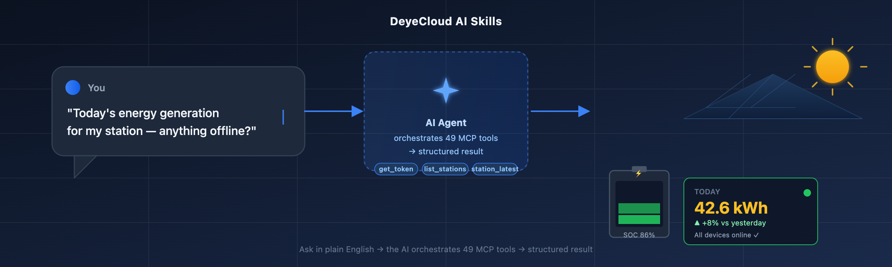

# DeyeCloud AI Skills

<p align="center">
  <em>Talk to your solar & battery storage stations in plain English.</em>
</p>

<p align="center">
  
</p>

<p align="center">
  <a href="https://modelcontextprotocol.io"></a>
  <a href="LICENSE"></a>
  
  
</p>

---

**DeyeCloud AI Skills** are installable instruction packs that teach AI coding
agents (Codex, Claude, ChatGPT, …) how to operate DeyeCloud solar & battery
storage stations through natural language. They sit on top of the
[Deye Open MCP server](https://developer.deyecloud.com/openmcp/mcp) and turn
49 raw API tools into 6 ready-made business scenarios — so instead of reading
API docs and writing glue code, you just ask.

> **One line to get started** (in your AI agent):
> *"Today's energy generation for my station — and is anything offline?"*

The AI will authenticate, list your stations, fetch generation + device status,
combine the results, and reply with a structured health report. No copy-pasting
endpoints, no glue code.

## ✨ What's inside

| Skill | What it does | Best for |
|---|---|---|
| **deye-openapi-quickstart** | Onboard a developer from zero to first successful API call — registration, access token, data center, control commands. | Developers integrating DeyeCloud OpenAPI |
| **deye-monitoring-best-practices** | Advise on optimizing polling frequency, caching, QPM, device command concurrency — stay within quota. | Developers tuning an existing integration |
| **deye-cloud-scenarios** | Upper-layer scenario playbooks: station inspection, energy report, battery strategy, device diagnostics, station compare. | End users & operators who want answers, not API calls |

## 🚀 Quick Start

### 1. Connect the MCP server

Point your AI client at the Deye Open MCP server:

```
https://developer.deyecloud.com/openmcp/mcp
```

- **Codex / Codex CLI**: add to MCP config
- **Claude Desktop / Claude Code**: add to `claude_desktop_config.json`
- **Any MCP-compatible client**: streamable HTTP transport

### 2. Install the skills

Download the latest bundle from [Releases](../../releases/latest), unzip, and
drop the `SKILL.md` files into your agent's skills directory:

| Agent | Skill path |
|---|---|
| Codex (desktop) | `~/.codex/skills/<name>/SKILL.md` |
| Claude Code | `~/.claude/skills/<name>/SKILL.md` |
| Generic | wherever your client loads skills from |

Or clone this repo and symlink:

```bash
git clone https://github.com/DeyeCloudDevelopers/deyecloud-skills.git
# then point your agent at deyecloud-skills/
```

### 3. Provide credentials

When you first ask something, the AI will guide you through:

1. Register at [developer.deyecloud.com/app](https://developer.deyecloud.com/app) → get `AppId` / `AppSecret`
2. Pick a data center (EU / Americas / India — match where your devices are)
3. Obtain an `access_token` (the skill handles this automatically)
4. Ask away.

## 📋 Scenarios

The `deye-cloud-scenarios` skill ships these ready-made playbooks:

| # | Scenario | Trigger examples |
|---|---|---|
| 1 | Station inspection | "电站巡检" / "station health" |
| 2 | Energy report | "今天发了多少电" / "today's generation" |
| 3 | Battery strategy | "电池策略" / "battery SOC" |
| 4 | Real-time status | "实时功率" / "live power" |
| 5 | Device diagnostics | "设备离线" / "device offline" |
| 6 | Station compare | "电站对比" / "compare stations" |

Each scenario defines: trigger words → ordered tool calls → AI interpretation
strategy. The AI orchestrates the 49 MCP tools and returns a human-readable
conclusion.

## 🔧 Data centers

| Device location | Data center | `data_center` key | Base URL |
|---|---|---|---|
| Europe / Africa / Asia-Pacific | EU | `eu` | `https://eu1-developer.deyecloud.com` |
| North / South America | Americas | `am` | `https://us1-developer.deyecloud.com` |
| India | India | `india` | `https://india-developer.deyecloud.com` |

Data is region-isolated; a cross-region base URL will not return your devices.

## ❓ FAQ

**Is my data sent to a third party?**
No. The AI agent calls the Deye Open MCP server directly with your token. Your
credentials never leave your environment. Each call counts against your OpenAPI
quota, just like a direct API call.

**Does this replace the API?**
No — it *wraps* the API. Every natural-language query maps to real MCP tool
calls, which map to real OpenAPI endpoints. It's a convenience layer, not a
new data source.

**Which AI clients are supported?**
Any client that supports the Model Context Protocol: Codex, Claude, ChatGPT,
Cursor, and others. The skills are plain `SKILL.md` markdown, so they're
client-agnostic.

**Is there a cost?**
The skills are open source (MIT). Normal OpenAPI quota and rate limits apply to
the underlying tool calls — see
[Best Practices](https://developer.deyecloud.com/best-practices).

## 📦 Bundle

A versioned zip is published with each [Release](../../releases/latest):

```
deye-open-mcp-skills-v<YYMMDD>.zip
├── deye-openapi-quickstart/SKILL.md
├── deye-monitoring-best-practices/SKILL.md
└── deye-cloud-scenarios/SKILL.md
```

Your AI agent auto-checks `latest-version.txt` on each session start and can
self-update.

## 🔗 Links

- **Developer Portal**: [developer.deyecloud.com](https://developer.deyecloud.com)
- **Skills install page**: [developer.deyecloud.com/skills](https://developer.deyecloud.com/skills)
- **API Documentation**: [developer.deyecloud.com/api](https://developer.deyecloud.com/api)
- **Best Practices**: [developer.deyecloud.com/best-practices](https://developer.deyecloud.com/best-practices)
- **MCP Server endpoint**: `https://developer.deyecloud.com/openmcp/mcp`

## 🤝 Contributing

Issues and PRs welcome. See [CONTRIBUTING.md](CONTRIBUTING.md) for guidelines.

## License

[MIT](LICENSE) © DeyeCloud
